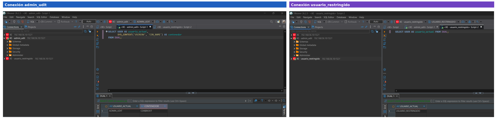
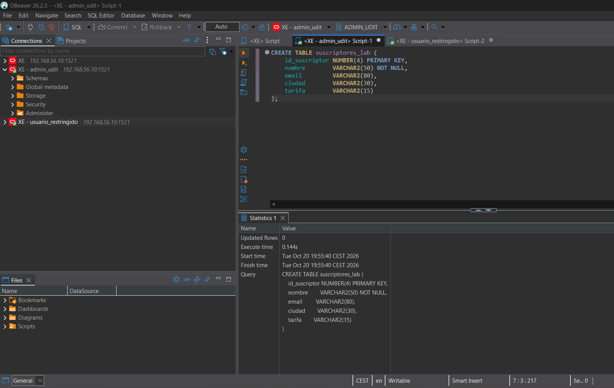
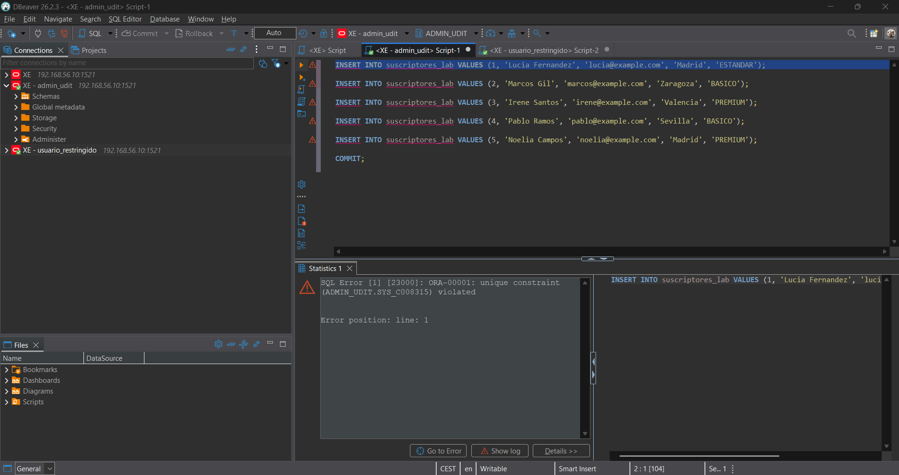
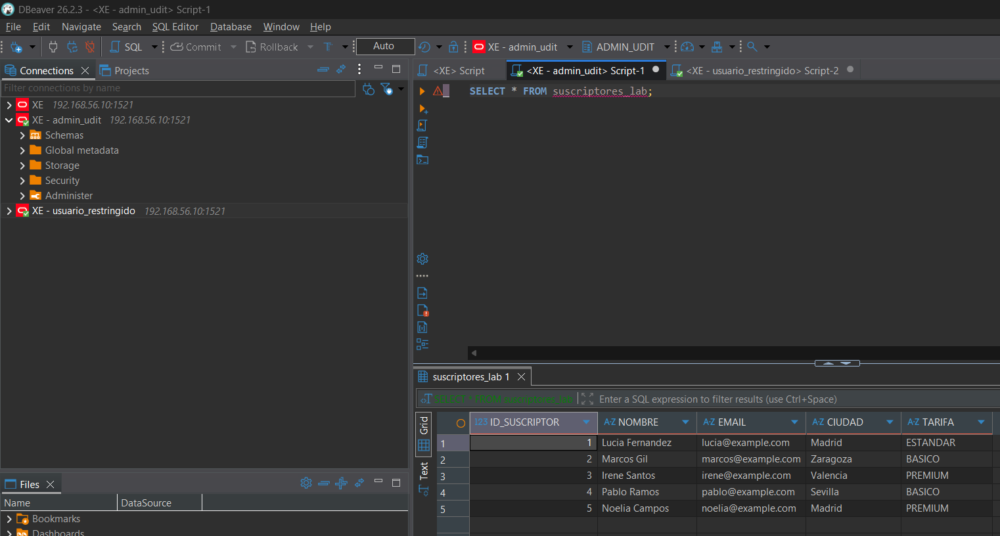
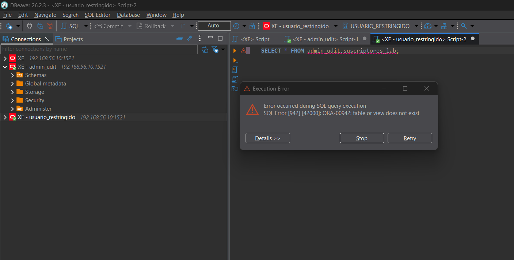
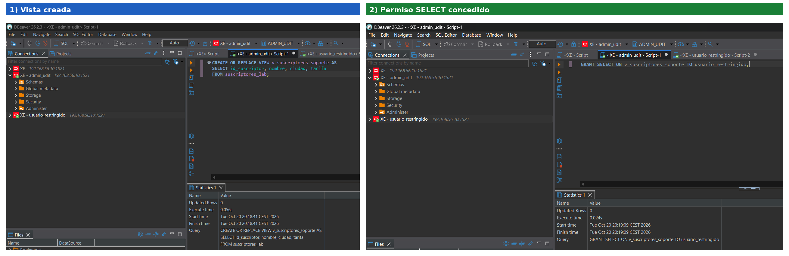
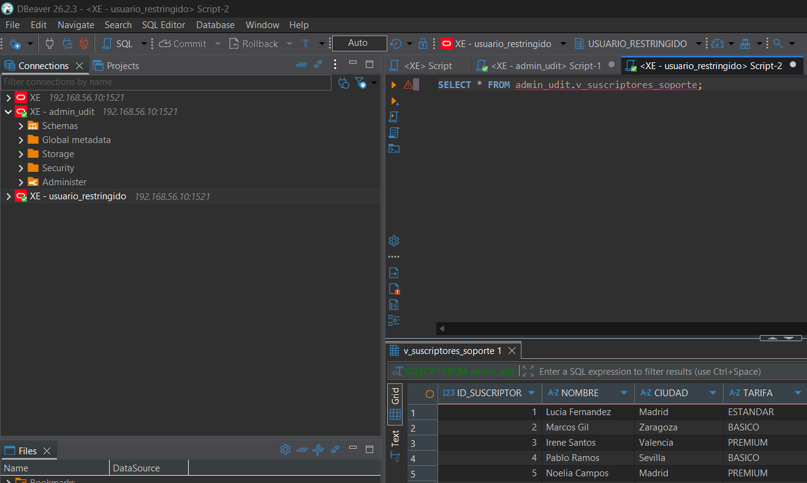
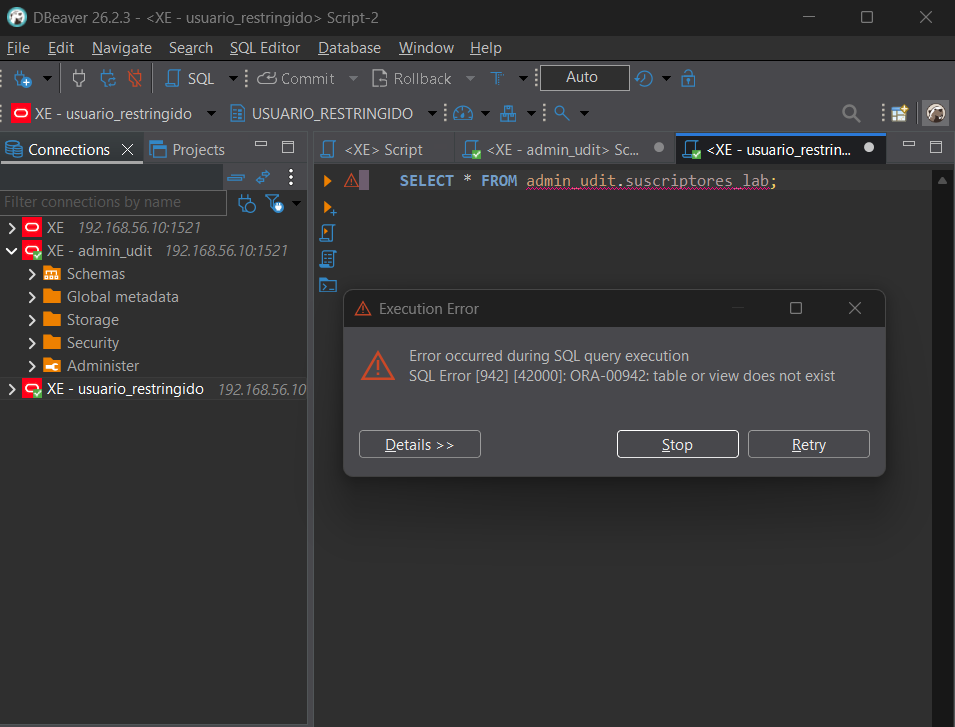
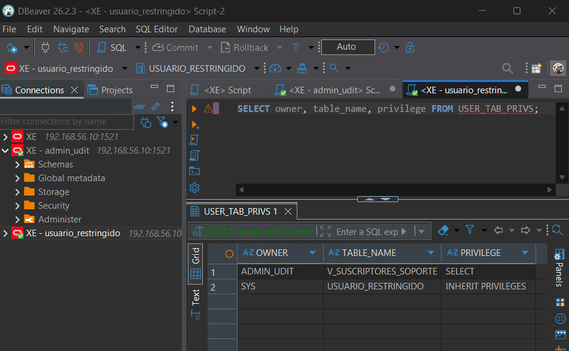
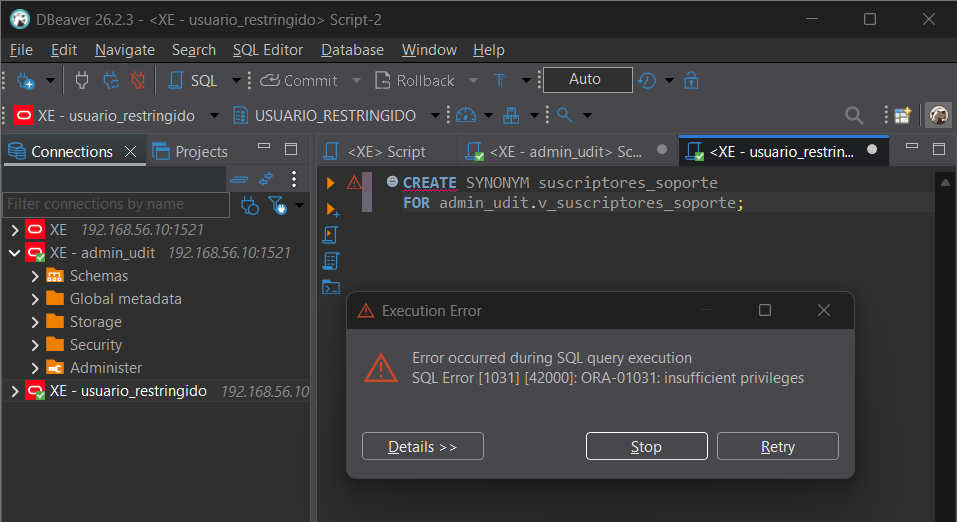

# Laboratorio guiado: tablas, vistas y permisos en Oracle XE

| Dato | Información |
|---|---|
| Alumno | Tomas Franco Brusse |
| Módulo | 0377 · Administración de sistemas gestores de bases de datos |
| Ciclo | 2.º ASIR · UDIT · Curso 2026/27 |
| Tipo | Práctica guiada no evaluable |
| Entorno | El mismo del Reto 2: Oracle Database 21c XE en mi VM (`192.168.56.10`) y DBeaver en mi PC |
| Cuentas | `admin_udit` y `usuario_restringido`, creadas en el Reto 2 |

## 1. Objetivo

Ver la diferencia entre una **tabla** (donde están los datos) y una **vista** (una consulta guardada que enseña solo algunas columnas), y comprobar que se puede dar permiso sobre la vista sin darlo sobre la tabla.

No he creado usuarios nuevos ni tocado el firewall ni la configuración de Oracle.

## 2. Antes de empezar

En DBeaver tengo las dos conexiones del Reto 2 (`XE - admin_udit` y `XE - usuario_restringido`). Comprobé las dos:

```sql
SELECT USER AS usuario_actual,
       SYS_CONTEXT('USERENV', 'CON_NAME') AS contenedor
FROM DUAL;
```

```sql
SELECT USER AS usuario_actual FROM DUAL;
```

La primera da `ADMIN_UDIT` en `CDB$ROOT` (el contenedor principal, donde lo creé) y la segunda `USUARIO_RESTRINGIDO`.

**Evidencia 1:**



## 3. Parte A: crear una tabla

**Conexión: `admin_udit`.**

### Paso 1. Crear la tabla

```sql
CREATE TABLE suscriptores_lab (
    id_suscriptor NUMBER(4) PRIMARY KEY,
    nombre        VARCHAR2(50) NOT NULL,
    email         VARCHAR2(80),
    ciudad        VARCHAR2(30),
    tarifa        VARCHAR2(15)
);
```

Una tabla de suscriptores con cinco columnas, vacía de momento.

**Evidencia 2:**



### Paso 2. Insertar datos ficticios

```sql
INSERT INTO suscriptores_lab VALUES (1, 'Lucia Fernandez', 'lucia@example.com', 'Madrid', 'ESTANDAR');
INSERT INTO suscriptores_lab VALUES (2, 'Marcos Gil', 'marcos@example.com', 'Zaragoza', 'BASICO');
INSERT INTO suscriptores_lab VALUES (3, 'Irene Santos', 'irene@example.com', 'Valencia', 'PREMIUM');
INSERT INTO suscriptores_lab VALUES (4, 'Pablo Ramos', 'pablo@example.com', 'Sevilla', 'BASICO');
INSERT INTO suscriptores_lab VALUES (5, 'Noelia Campos', 'noelia@example.com', 'Madrid', 'PREMIUM');
COMMIT;

SELECT * FROM suscriptores_lab;
```

El `COMMIT` es lo que guarda los datos de verdad; sin él, los otros usuarios no los verían.

> Sin querer ejecuté el primer `INSERT` dos veces y salió `ORA-00001`: el `id` 1 ya existía y, al ser `PRIMARY KEY`, no se puede repetir. Comprobé la tabla antes de seguir y no repetí nada más.
>
> 

**Evidencia 3:** cinco filas y cinco columnas.



## 4. Parte B: comprobar el acceso restringido

Con la conexión `usuario_restringido`:

```sql
SELECT * FROM admin_udit.suscriptores_lab;
```

Sale `ORA-00942: table or view does not exist`. La tabla existe, pero a quien no tiene permiso Oracle le dice que no.

**Evidencia 4:**



## 5. Parte C: crear una vista y conceder acceso

### Paso 1 y 2. Crear la vista y dar permiso

Con `admin_udit`:

```sql
CREATE OR REPLACE VIEW v_suscriptores_soporte AS
SELECT id_suscriptor, nombre, ciudad, tarifa
FROM suscriptores_lab;

GRANT SELECT ON v_suscriptores_soporte TO usuario_restringido;
```

La vista enseña todo menos el `email`, y el `GRANT` deja a `usuario_restringido` consultar **solo la vista**.

**Evidencia 5:**



### Paso 3. Probar la vista

Con `usuario_restringido`, una a una:

```sql
SELECT * FROM admin_udit.v_suscriptores_soporte;
```

Cinco filas y cuatro columnas (`ID_SUSCRIPTOR`, `NOMBRE`, `CIUDAD`, `TARIFA`).

**Evidencia 6:**



```sql
SELECT email FROM admin_udit.v_suscriptores_soporte;
```

`ORA-00904: "EMAIL": invalid identifier`, porque la vista no tiene esa columna.

**Evidencia 7:**


```sql
SELECT * FROM admin_udit.suscriptores_lab;
```

Otra vez `ORA-00942`: el permiso es sobre la vista, no sobre la tabla.

**Evidencia 8:**



### Extra: qué permisos tiene `usuario_restringido`

Como `usuario_restringido` miré qué permisos tiene:

```sql
SELECT owner, table_name, privilege FROM USER_TAB_PRIVS;
```



Solo `SELECT` sobre la vista; sobre la tabla nada. La línea de `INHERIT PRIVILEGES` la pone Oracle por defecto al crear cualquier usuario.

## 6. Ampliación opcional: sinónimo privado

Lo intenté como `usuario_restringido`:

```sql
CREATE SYNONYM suscriptores_soporte
FOR admin_udit.v_suscriptores_soporte;
```

Salió `ORA-01031`: este usuario solo tiene `CREATE SESSION`, así que no puede crear sinónimos. Como pide el enunciado, no le di más permisos: la ampliación queda **sin hacer** y no hay evidencia 9.



## 7. Ejercicio breve

**1. ¿Qué diferencia hay entre una tabla y una vista?**

La tabla guarda los datos. La vista no guarda nada: es una consulta con nombre que enseña solo una parte de la tabla (aquí, todo menos el email).

**2. ¿Por qué `usuario_restringido` puede consultar la vista, pero no la tabla?**

Porque los permisos van por objeto: le di `SELECT` sobre la vista y nada sobre la tabla. La vista lee la tabla con los permisos de su dueño (`admin_udit`).

**3. ¿Por qué pedir `EMAIL` a la vista produce `ORA-00904`?**

Porque la vista no tiene esa columna: al crearla solo elegí `id_suscriptor`, `nombre`, `ciudad` y `tarifa`.

**4. ¿Un sinónimo concede permisos? ¿Por qué?**

No. Es solo un nombre más corto para el objeto; si no tienes permiso sobre él, con el sinónimo tampoco entras.

## 8. Checklist final

- [x] He comprobado las conexiones de `admin_udit` y `usuario_restringido`.
- [x] He consultado la tabla con cinco filas como `admin_udit`.
- [x] He comprobado el acceso denegado a la tabla como `usuario_restringido`.
- [x] He creado la vista y concedido `SELECT`.
- [x] He consultado la vista con cinco filas y cuatro columnas.
- [x] He comprobado por qué `EMAIL` produce `ORA-00904`.
- [x] Puedo explicar por qué un sinónimo no concede permisos.
- [x] No he modificado usuarios, contraseñas ni configuración del servidor.
